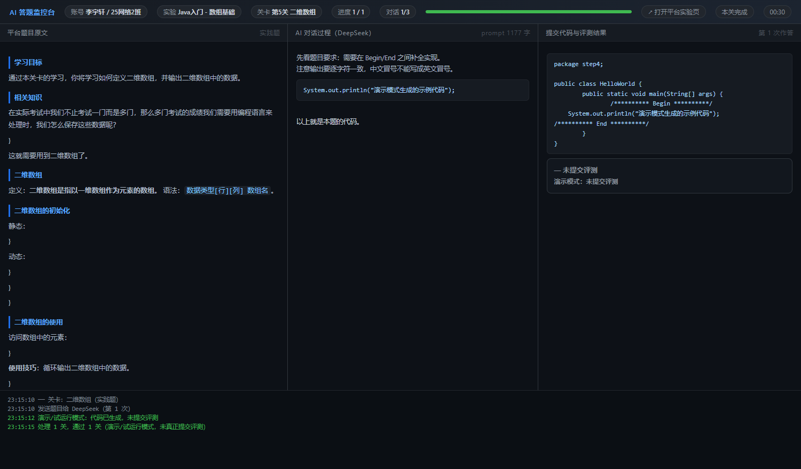

# Tempo 实训平台 · AI 自动答题助手

用**网页版 DeepSeek** 自动完成美林 Tempo 实训平台（`tempo-talents`）里的课程实验关卡，
支持**编程题**和**选择题 / 判断题**，全程有实时监控面板，题目、AI 作答、最终结果同屏可见。

> 仅供个人学习与效率研究使用，请遵守所在学校的学术规范。



---

---

## ⚠️ 第一次使用请先看这里

按顺序做，**不要跳步**：

### 第 1 步：确认你的 Python 是真的

打开「命令提示符」（Win + R 输入 `cmd` 回车），执行：

```bat
python --version
```

| 你看到的 | 说明 |
| --- | --- |
| `Python 3.10.x` 或更高 | ✅ 正常，进入第 2 步 |
| 弹出 Microsoft Store / 窗口一闪而过 / 报"不是内部或外部命令" | ❌ 你的 `python` 是**空壳**，见下方处理 |

**空壳的处理办法**：去 <https://www.python.org/downloads/> 下载安装包，
安装第一步**务必勾选** `Add python.exe to PATH`，装完重开一个 cmd 再验证。

> 为什么会这样：Windows 默认在 PATH 里放了一个
> `AppData\Local\Microsoft\WindowsApps\python.exe` 的"应用执行别名"，
> 它不运行任何东西、静默退出，看起来就像程序"什么都没干"。

### 第 2 步：安装依赖（只需一次）

双击 **`install.bat`**，它会创建 `.venv` 并安装 playwright 等依赖。
看到 `Done. Next: run login.bat` 才算成功。

### 第 3 步：登录（只需一次）

双击 **`login.bat`**：

1. 平台会用 `config.json` 里的账号自动登录；
2. 浏览器打开 DeepSeek，请**手动扫码 / 输密码**；
3. 回终端按回车，确认显示「已就绪」。

### 第 4 步：开始答题

双击 **`启动.bat`**，选 `3`。

---

### 三个容易踩的坑

| 坑 | 说明 |
| --- | --- |
| **跳过 install.bat** | 会提示「缺少依赖：playwright」，必须先装 |
| **把 `.venv` 拷给别人 / 换电脑** | `.venv` 里的 Python 绑定了创建时的绝对路径，**不能复制**，换机器要重新跑 `install.bat` |
| **以为登录状态会跟着仓库走** | `data/profile`（登录态）在 `.gitignore` 里，从 GitHub 下载的项目**必须重新 `login.bat`** |

---

## 特性

- **两种题型**：编程题（生成代码 → 写回 → 评测）、选择题 / 判断题（作答 → 提交 → 评测）
- **实时监控面板**：左边题目原文、中间 AI 逐字输出、右边最终代码与评测结果，底部运行日志
- **答案自动修正**：评测不通过时，把「预期输出 vs 实际输出」的差异（精确到第几个字符）回传给 AI 重新作答
- **上下文自动回收**：每做 3 题就删掉当前对话、新开一个，避免上下文过长导致响应变慢
- **跑完自动清理**：结束时把本次在 DeepSeek 里产生的对话全部删除，不留垃圾
- **环境自动启动**：平台的实训容器按需启动，程序会自动初始化并等到就绪
- **范围控制**：一条指令指定章节 / 实验范围，跑前先列清单让你核对

---

## 快速开始

### 1. 安装依赖

```bash
pip install -r requirements.txt
```

需要 Python 3.10+，以及本机装有 Edge 或 Chrome（程序复用系统浏览器，不额外下载 Chromium）。

### 2. 配置

首次运行任意命令时，程序会自动从 `config.example.json` 生成 `config.json` 然后退出。
打开 `config.json` 填写：

```jsonc
{
  "platform": {
    "base_url": "http://你的平台地址/tempo-talents/",
    "username": "你的学号或账号",
    "password": "你的密码",
    "classroom_id": ""        // 留空即可，程序会自动选你加入的第一个课堂
  }
}
```

### 3. 登录（只做一次）

```bash
python main.py login
```

弹出浏览器后：

1. 平台会自动用 `config.json` 里的账号登录；
2. 打开 DeepSeek 对话页，**手动扫码或输密码登录**；
3. 回到终端按回车，会告诉你是否登录成功。

登录状态保存在 `data/profile`，之后不用再登。

### 4. 开始答题

```bash
python main.py run
```

或者用菜单（不带参数运行）：

```bash
python main.py
```

---

## 范围指令

选完「自动答题」后，程序只问一条指令：

| 输入 | 含义 |
| --- | --- |
| 直接回车 | 全部实验里所有未完成的关 |
| `第1章` / `第三章` | 该章全部实验（中文数字也认） |
| `第1章 1-5` | 第 1 章的 1-1 到 1-5 号实验 |
| `1-3` | 只做 1-3 号实验 |
| `第2章 2` | 第 2 章第 2 个实验 |
| `Java高级特性` | 按实验名 / 章名模糊匹配 |

输入后会先打印清单给你核对：

```
范围：第1章 第1~5个实验
将处理 5 个实验：
     1-1  Java入门 - 初体验
     ...
计划处理 23 关
```

清单不对就 Ctrl+C 中断，此时还没动过成绩。

> **耗时**：每个实验的实训容器首次启动要 10~40 秒，换实验时会重新启动。
> 一个实验（约 5 关）通常 1~3 分钟，一整章十几分钟属于正常。

---

## 常用命令

```bash
python main.py login                 # 登录（平台 + DeepSeek）
python main.py list                  # 列出实验与关卡（✓ 已完成）
python main.py run                   # 全部未完成
python main.py run --scope "第1章 1-5"
python main.py run --scope "1-3" --steps 2-4    # 再做该实验的第 2~4 关
python main.py run --limit 3         # 最多做 3 关
python main.py run --dry-run         # 调 AI 但不提交评测
python main.py run --demo            # 演示模式：假 AI + 不提交，只看界面
python main.py ai-test               # 测试 DeepSeek 通道是否正常
python main.py check                 # 环境自检
```

---

## 配置项

```jsonc
{
  "ai": {
    "answer_timeout": 180          // 等 AI 回答的最长秒数
  },
  "run": {
    "max_retry": 2,                // 评测失败后重答次数
    "delay_between_steps": 3,      // 每关之间的间隔
    "skip_passed": true,           // 跳过已通过的关
    "cleanup_chat": true,          // 跑完删除本次产生的 DeepSeek 对话
    "questions_per_chat": 3        // 每 3 题换一个对话
  }
}
```

---

## 项目结构

```
tempo-ai-answer/
├─ main.py               命令行入口 + 交互菜单
├─ config.example.json   配置模板（不含任何个人信息）
├─ bot/
│  ├─ platform.py        平台接口：登录、启动环境、抓题、提交、评测
│  ├─ ai_web.py          DeepSeek 网页版驱动（单对话、流式读取）
│  ├─ solver.py          拼 prompt、合并代码、答案解析、失败重答
│  └─ dashboard.py       实时监控面板（本地 HTTP 服务）
├─ docs/preview.png      面板截图
├─ data/profile/         浏览器登录态（自动生成，已被 .gitignore 排除）
└─ logs/                 日志目录
```

---

## 工作原理

程序不走截图 OCR，而是直接调用平台接口：

```
登录平台
  → 初始化该实验的实训容器（10~40 秒）
  → 拉取题目 / 代码框架 / 测试用例
  → 拼成 prompt 交给网页版 DeepSeek（整个运行共用少量对话，每 3 题换一次）
  → 取回代码或答案 → 写回平台 → 触发评测
  → 未通过则把「预期 vs 实际」的精确差异回传，让 AI 修正（默认重试 2 次）
  → 跑完删除本次产生的对话
```

几个实现细节值得一提：

- 平台接口必须带 `X-Requested-With: XMLHttpRequest`，否则会被网关重定向到登录页；
- 账号密码在前端做了加密，所以登录走浏览器表单而不是直接调接口；
- 请求全部在页面上下文里用 `fetch` 发出，自动携带 cookie；
- DeepSeek 页面上没有可靠的「生成中」标志，判断回答是否写完靠内容特征（代码闭合、段落齐全）+ 文本稳定时长；
- 代码块顶部的「java / 复制 / 下载」工具栏会被剔除，否则会混进代码导致编译失败；
- 多个文件时按 `===FILE: 路径===` 分节生成并回填，同时强制 `public class` 名与文件名一致。

---

## 常见问题

**Q：双击 bat 只弹出空白窗口，只有一行 `Press any key to continue`**

Windows 里 PATH 上的 `python` 可能是 **Microsoft Store 的应用执行别名**——一个空壳程序，
执行后不输出任何内容、直接以退出码 49 结束，看起来就是"什么都没发生"。

新版脚本会自动跳过这个假入口去找真正的 Python。如果它报 `No usable Python found`，
说明机器上确实没有可用的 Python：去 <https://www.python.org/downloads/> 装 3.10+，
**安装时勾选 "Add python.exe to PATH"**，然后运行 `install.bat`。

**Q：提示「缺少依赖：playwright」**

还没装依赖，运行 `install.bat`（或 `pip install -r requirements.txt`）。

**Q：提示「DeepSeek 尚未登录」**

运行 `login.bat`，在弹出的浏览器里扫码或输密码。

**Q：提示「实践环境尚未初始化或已关闭」**

正常现象——该实验的容器还没启动，程序会自动初始化并等 10~40 秒。

**Q：跑久了 AI 变慢**

网页版上下文有限，程序每 3 题会自动换一个新对话（见 `questions_per_chat`）。

---

## 已知限制

| 情况 | 说明 |
| --- | --- |
| 命令行类关卡 | 题目给的是 `README.md`，要求你在实训终端里敲命令（如安装 JDK），程序会识别并跳过 |
| 多文件题 | 已支持，但个别题（目录树缩进这类）AI 可能反复出错，重试 3 次不过会自动跳过 |
| 平台判定细节 | 极少数题预期输出与判定逻辑不一致（例如只差结尾换行），会一直不过，建议手动完成 |
| 图形验证码 | 登录时如果出现验证码，程序会提示你在浏览器窗口里手动填写 |

---

## 免责声明

本项目仅用于**学习浏览器自动化与接口调试技术**。
把它用于课程作业、考试成绩等场景可能违反你所在学校的学术诚信规定，请自行判断并承担后果。
作者不对使用本工具造成的任何后果负责。

平台接口与页面结构随时可能变化，本项目不保证长期可用。

---

## License

[MIT](LICENSE)
